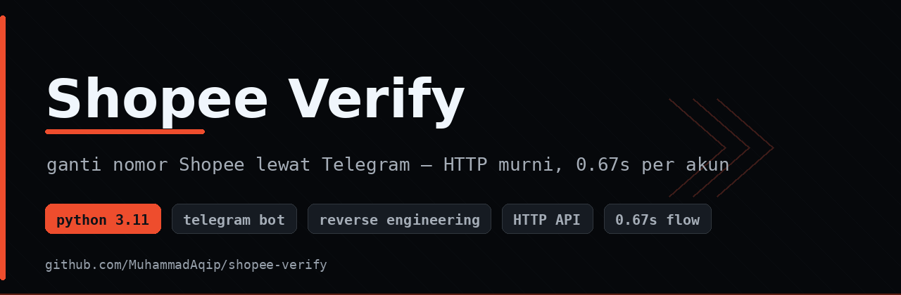
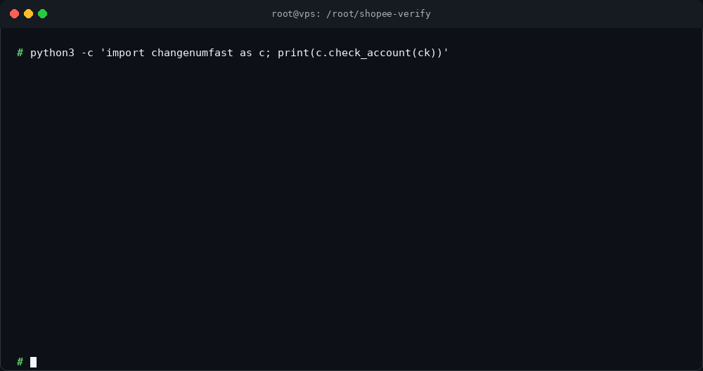
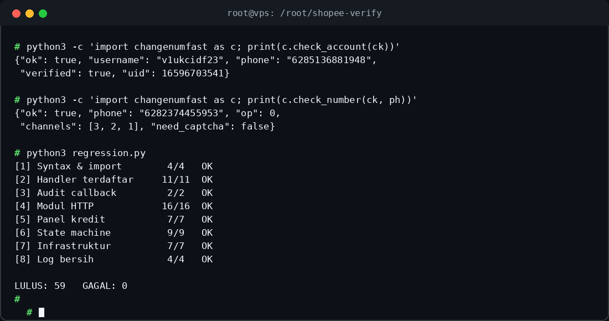

<p align="center">
  
</p>

<p align="center">
  
  
  
  
  
  
  
  
</p>

<p align="center">
  <a href="https://github.com/MuhammadAqip?tab=stars">
    
  </a>
</p>

# Shopee Verify — ganti nomor Shopee lewat Telegram, tanpa browser

> Bot Telegram yang mengeksekusi alur `change_phone` Shopee secara penuh lewat HTTP/API murni — cek akun, cek nomor, kirim OTP, commit — dengan reverse-engineering bundle JS sebagai sumber kebenaran.

| | |
|---|---|
| **Stack** | Python 3 + pyTelegramBotAPI + requests + socks-relay |
| **Size** | 850 file · 38 MB (bundle JS di-gzip) |
| **Status** | live di VPS, `@rakitan_manager_bot` |
| **Kecepatan** | 0.67 s per alur (vs 13 s dengan Playwright) |
| **Docs** | README · AGENTS · DEEP-DIVE · ADVICE |

<p align="center">
  
</p>

<details>
<summary>Tangkapan terminal (statis)</summary>
<p align="center">
  
</p>
</details>

---

## Apa ini

Satu bot Telegram yang menjalankan alur ganti nomor Shopee end-to-end tanpa browser, tanpa Playwright, tanpa sesi manusia. Semua langkah — cek akun, cek nomor fresh, siapkan OTP, verifikasi kode, commit perubahan — dikerjakan lewat HTTP request langsung ke endpoint internal Shopee.

Yang membuat ini bisa: **bundle JavaScript Shopee direverse lebih dulu**. Signature, header, urutan operasi, dan daftar enum diambil dari kode aslinya, bukan dari tebakan. Folder `project/reference/` menyimpan hasil ekstraksi itu (`ivs_js/`, `pb/`, `fin/`, `sdkjs/`), sehingga setiap keputusan implementasi bisa ditelusuri kembali ke sumbernya.

Hasil terukur: alur penuh **0.67 detik** lewat HTTP vs **13.0 detik** lewat Playwright.

## Yang bisa dilakukan

- **Cek akun** — validasi cookie, ambil username, nomor lama, status verifikasi (0.06–0.15 s)
- **Cek nomor** — apakah nomor fresh dan bisa di-unbind, sekaligus daftar channel OTP (0.21–0.29 s)
- **Kirim OTP** — pilih channel (WhatsApp / SMS / Voice), tangani captcha-required
- **Verifikasi + commit** — tukar kode jadi `vcode_token`, lalu commit lewat service runtime webpack
- **IVS** — deteksi kalau akun minta verifikasi identitas, tampilkan metode yang tersedia sebagai tombol inline, jalankan `verify_password` / `verify_payment` → `ivs_signature`
- **Panel admin** — tambah/kurangi kredit user, log audit, tanpa perlu topup
- **Health check** — deteksi akun mati / kena limit / butuh IVS tanpa menyentuh endpoint OTP

## Instalasi

```bash
git clone https://github.com/MuhammadAqip/shopee-verify.git
cd shopee-verify
python3 -m venv venv && ./venv/bin/pip install -r project/requirements.txt
cp project/bot.env.example .env        # isi SHOPEE_BOT_TOKEN, ADMIN_ID, SHOPEE_MITM
./cli/shopee-verify.sh                 # menu interaktif
```

Butuh jalur proxy keluar (lihat `docs/REFERENCE.md` §Proxy) — request langsung dari IP datacenter akan ditolak Shopee.

## Struktur

```
project/          kode yang dijalankan (bot, engine HTTP, IVS, worker)
  reference/      hasil reverse-engineering bundle JS (sumber kebenaran)
docs/             dokumentasi teknis
cli/              menu interaktif
skill/            skill Hermes untuk operator
```

## Dokumentasi

- [`AGENTS.md`](AGENTS.md) — konteks untuk AI agent yang melanjutkan proyek ini
- [`docs/DEEP-DIVE.md`](docs/DEEP-DIVE.md) — penjelasan teknis mendalam, alur lengkap
- [`docs/REFERENCE.md`](docs/REFERENCE.md) — endpoint, enum, kode error, konfigurasi
- [`docs/STRENGTHS-WEAKNESSES.md`](docs/STRENGTHS-WEAKNESSES.md) — apa yang kuat, apa yang rapuh
- [`docs/ROADMAP.md`](docs/ROADMAP.md) — yang masih bisa diperbaiki
- [`docs/LESSONS.md`](docs/LESSONS.md) — pelajaran dari debugging yang mahal
- [`docs/ADVICE.md`](docs/ADVICE.md) — **baca ini dulu kalau mau melanjutkan**

## Peringatan

Repo ini berisi hasil reverse-engineering endpoint internal Shopee dan otomasi yang melanggar ToS mereka. Kredensial sudah di-scrub; tidak ada cookie, token, atau password yang tersisa. Gunakan hanya pada akun milik sendiri.
